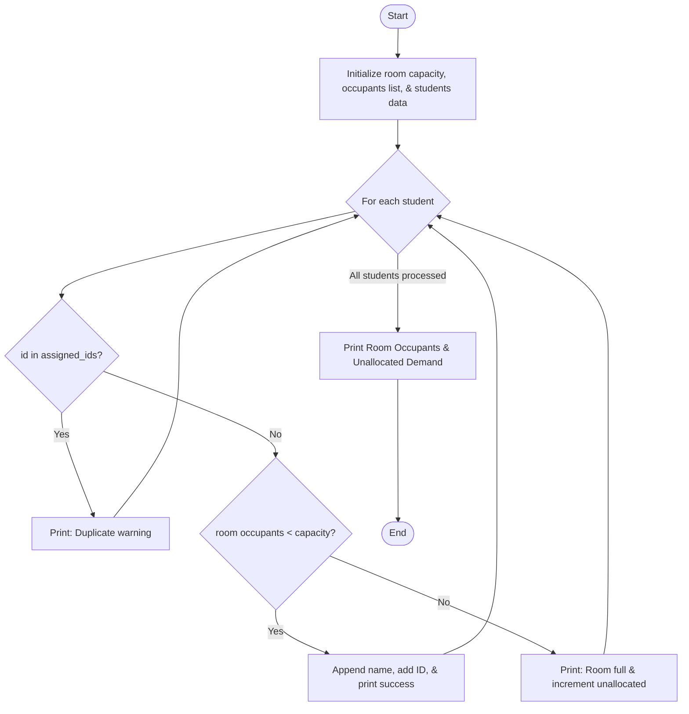

## Problem Statement
Write a Python program to manage room allocation for students with capacity constraints and duplicate checking. The system must:
Maintain a fixed room capacity (e.g., 2 occupants).

Process a list of student tuples containing a unique ID and a name.

Check if a student ID has already been assigned to prevent duplicate bookings.

Check if the room has available space before allocating.

Track and count any unallocated student demand when the room is full.

Output the final list of room occupants and the total unallocated count.


## Algorithm
1.Start and initialize room_capacity = 2, an empty room_occupants list, an empty assigned_ids set, unallocated = 0, and the students list.

2.For each (id, name) in students:

3.Check if id in assigned_ids:

4.If True: Print a duplicate warning message.

5.Else, check if len(room_occupants) < room_capacity:

6.If True: Append name to room_occupants, add id to assigned_ids, and print success.

7.If False: Print that the room is full and increment unallocated by 1.

8.After the loop completes, print the final room_occupants list and the unallocated demand count.

9.End.

## Python Source Code
```
room_capacity = 2
room_occupants = []
assigned_ids = set()
unallocated = 0
students = [("S1", "Rupa"), ("S2", "Nitya"), ("S1", "Rupa"), ("S3", "Nandu")]

for id, name in students:
    if id in assigned_ids:
        print(f"Duplicate: {name} is already assigned.")
    elif len(room_occupants) < room_capacity:
        room_occupants.append(name)
        assigned_ids.add(id)
        print(f"Allocated {name} successfully.")
    else:
        print(f"Room is full! {name} unallocated.")
        unallocated += 1

print("Room Occupants:", room_occupants)
print("Unallocated Demand:", unallocated)
```
## Sample Testcase

Allocated Rupa successfully.

Allocated Nitya successfully.

Duplicate: Rupa is already assigned.

Room is full! Nandu unallocated.

Room Occupants: ['Rupa', 'Nitya']

Unallocated Demand: 1


## Flowchart 

