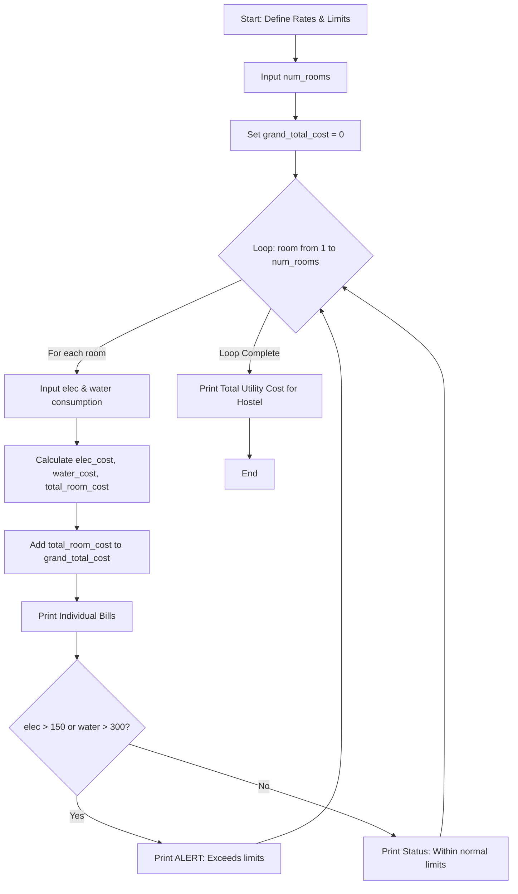

## Problem Statement
Write a simplified Python program to monitor and calculate utility bills for a given number of rooms in a hostel. The program must:

Input Usage: Prompt for electricity consumption (in kWh) and water consumption (units) for each room.

Calculate Charges: Compute electricity bills (6.5 per kWh) and water bills (4.0 per unit), along with the total room cost.

Threshold Monitoring: Check if electricity exceeds 150\text{ kWh} or water exceeds 300\text{ units}, printing an alert if limits are breached.

Grand Total: Accumulate and display the total utility cost for the entire hostel.

## Algorithm
1.Start the program and define constants: ELEC_RATE = 6.5, WATER_RATE = 4.0, ELEC_LIMIT = 150, and WATER_LIMIT = 30.

2.Prompt the user to input the num_rooms to monitor.

3.Initialize grand_total_cost = 0.

4.Loop through each room from 1 to num_rooms:

5.Input electricity consumption (elec) and water consumption (water).

6.Calculate elec_cost = elec * ELEC_RATE and water_cost = water * WATER_RATE.

7.Calculate total_room_cost = elec_cost + water_cost.

8.Add total_room_cost to grand_total_cost.

9.Print room electricity bill, water bill, and total room bill.

10.Check if elec > ELEC_LIMIT or water > WATER_LIMIT:

11.If true, print an ALERT message.

12.Else, print a Normal Status message.

13.After the loop finishes, print the grand_total_cost for the entire hostel.

14.End the program.

## Python source code
```
print(" Smart Hostel Resource Monitoring ")
ELEC_RATE = 6.5  
WATER_RATE = 4.0  
ELEC_LIMIT = 150  
WATER_LIMIT = 300  
num_rooms = int(input("Enter number of rooms to monitor: "))
grand_total_cost = 0

for room in range(1, num_rooms + 1):
    print(f"\n-- Room {room} --")
    elec = float(input("Enter electricity consumption (kWh): "))
    water = float(input("Enter water consumption (units): "))

    elec_cost = elec * ELEC_RATE
    water_cost = water * WATER_RATE
    total_room_cost = elec_cost + water_cost
    grand_total_cost += total_room_cost

    print(f"Electricity Bill: ₹{elec_cost:.2f}")
    print(f"Water Bill: ₹{water_cost:.2f}")
    print(f"Total Room Bill: ₹{total_room_cost:.2f}")

    if elec > ELEC_LIMIT or water > WATER_LIMIT:
        print("ALERT: Consumption exceeds threshold limits!")
    else:
        print("Status: Within normal limits.")

print()
print(f"Total Utility Cost for Hostel: ₹{grand_total_cost:.2f}")
```
## Sample Input & Output
Sample Input:

Enter number of rooms to monitor: 2

-- Room 1 --
Enter electricity consumption (kWh): 120
Enter water consumption (units): 200

-- Room 2 --
Enter electricity consumption (kWh): 160
Enter water consumption (units): 250


Sample output:

Smart Hostel Resource Monitoring 

-- Room 1 --
Electricity Bill: ₹780.00
Water Bill: ₹800.00
Total Room Bill: ₹1580.00
Status: Within normal limits.

-- Room 2 --
Electricity Bill: ₹1040.00
Water Bill: ₹1000.00
Total Room Bill: ₹2040.00
ALERT: Consumption exceeds threshold limits!

Total Utility Cost for Hostel: ₹3620.00

## Flowchart



