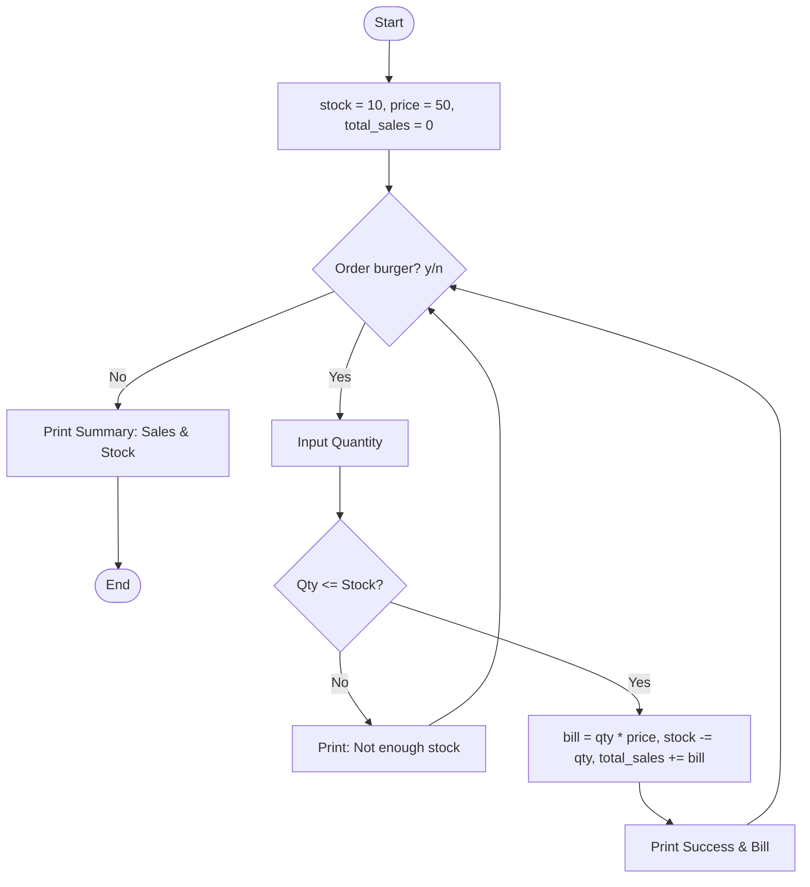

## Problem Statement

Write a Python program to manage canteen orders and inventory. The system must:
Maintain initial stock levels (e.g., 10 items) and a fixed item price (e.g., ₹50).

Run a continuous loop to process successive customer orders.

Accept or reject order quantities based on available inventory (qty <= stock).

Calculate individual bills, update remaining stock dynamically, and accumulate total sales.

Output a final daily sales and remaining stock summary when ordering concludes.

## Algorithm
1.Start and initialize stock = 10, price = 50, and total_sales = 0.

2.Enter a loop to process customer orders:

3.Display current stock left.

4.Prompt user whether they want to order (y/n).

5.If the response is not "y", exit the loop.

6.Prompt the user to enter the desired quantity (qty).

7.Check if qty <= stock:

8.If True: Calculate bill = qty * price, subtract qty from stock, add bill to total_sales, and print the success message with the bill amount.

9.If False: Print a rejection message for insufficient stock.

10.After exiting the loop, print the final summary showing Total Sales and Remaining Stock.

11.End.

## Python source code 
```
stock = 10
price = 50
total_sales = 0
while True:
    print(f"\nStock left: {stock}")
    ans = input("Order burger? (y/n): ")
    if ans != "y":
        break

    qty = int(input("Enter quantity: "))

    if qty <= stock:
        bill = qty * price
        stock -= qty
        total_sales += bill
        print(f"Success! Bill: ₹{bill}")
    else:
        print("Rejected! Not enough stock.")
print(f"Total Sales: ₹{total_sales}")
print(f"Remaining Stock: {stock}")
```

## Sample Input & Output
Sample input:

Order burger? (y/n): y
Enter quantity: 3
Order burger? (y/n): y
Enter quantity: 12
Order burger? (y/n): y
Enter quantity: 5
Order burger? (y/n): n


Sample output:

Stock left: 10
Order burger? (y/n): y
Enter quantity: 3
Success! Bill: ₹150

Stock left: 7
Order burger? (y/n): y
Enter quantity: 12
Rejected! Not enough stock.

Stock left: 7
Order burger? (y/n): y
Enter quantity: 5
Success! Bill: ₹250

Stock left: 2
Order burger? (y/n): n

Total Sales: ₹400
Remaining Stock: 2

## Flowchart



